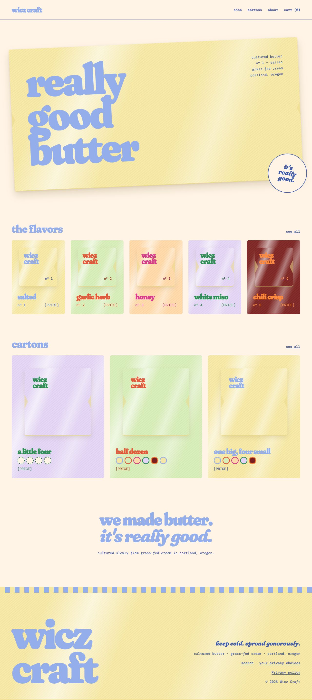
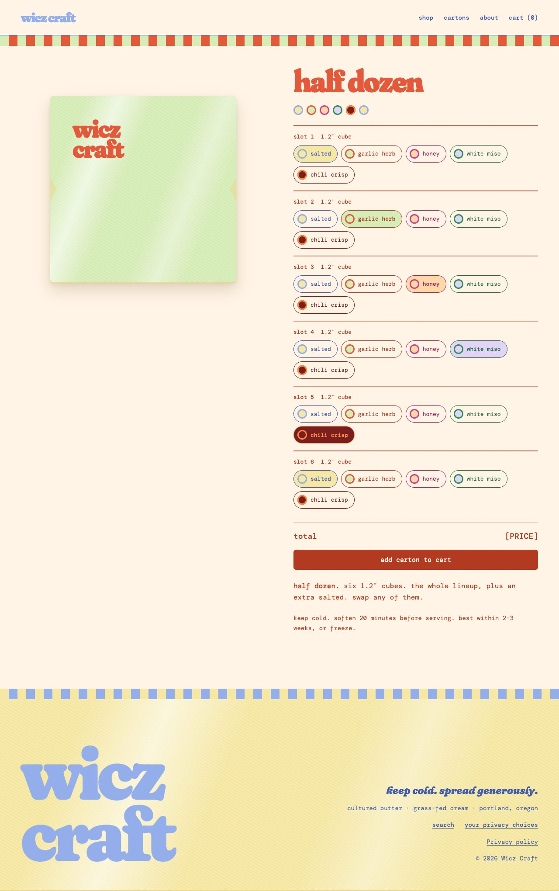
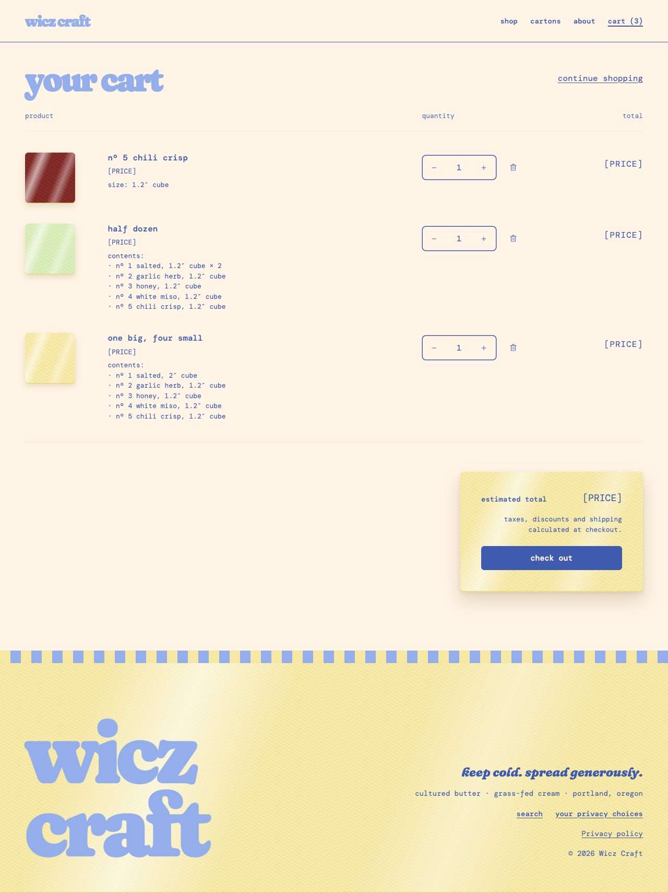
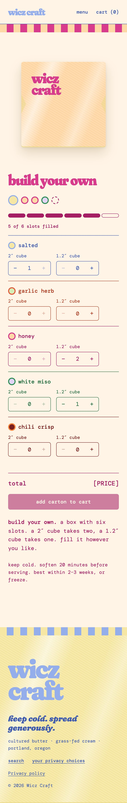
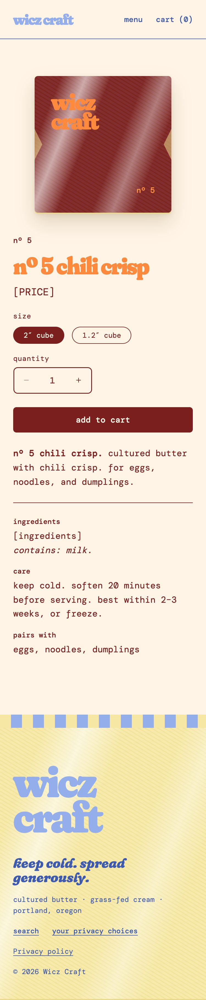
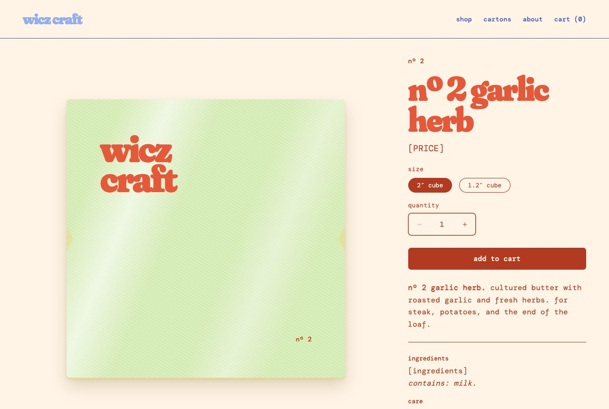
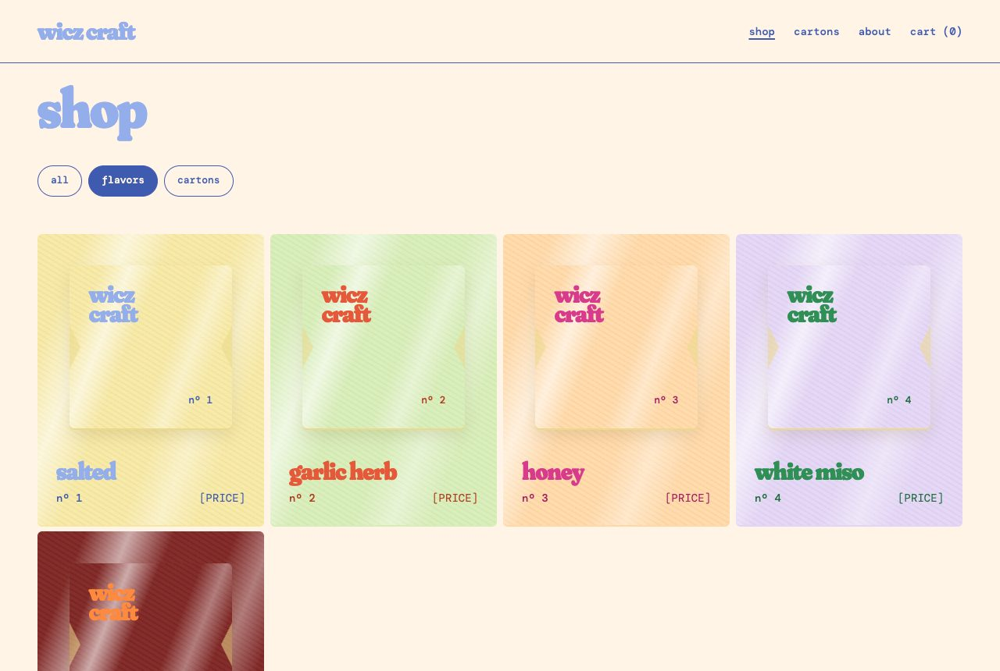

# wicz craft

A Shopify storefront for a fictional small-batch cultured butter company in
Portland, Oregon. Built on Dawn (Online Store 2.0) from a written design guide,
with a carton **bundle builder** backed by a **Cart Transform function**.

It's a practice and portfolio project: no real products, payments, or
customers, and prices are deliberately `[PRICE]` placeholders.



## What's interesting here

- **A bundle builder that ends up as one cart line.** Shoppers fill a carton
  slot by slot (or freely, up to a capacity). Each pick goes into the cart as
  its own line, and a Cart Transform function merges them into a single carton
  line priced as the sum of its cubes, with each flavor's inventory still
  tracked. [How it works ↓](#the-carton-bundle-builder)
- **Product pages that theme themselves.** Each flavor has ground / ink / deep
  colors in metafields. The page, buttons, pills and cards pick them up through
  CSS custom properties, with a contrast fallback computed in Liquid.
- **A design system enforced by an audit.** The guide's rules (lowercase,
  6px or 999px radii, one gradient, light inks only at display sizes, WCAG AA
  for body text) are checked page by page with a script, not by eye.
- **Everything stays editable in the theme editor.** Sections, blocks and
  settings, no hard-coded pages.

## Screenshots

| | |
|---|---|
|  |  |
| **Carton builder.** Preset cartons start with the guide's lineup; any slot can be swapped. Dots update live. | **Cart.** Two cartons, each merged into one line by the function, next to a loose cube. |
|  |  |
| **Build your own (375px).** A 2″ cube takes 2 slots, a 1.2″ cube takes 1. Buttons that would overflow the box turn off. | **Chili crisp (375px).** Tangerine fails AA on cream, so small text and the button switch to oxblood automatically. |
|  |  |
| **Flavor page.** Colors come from the product's metafields. | **Collection.** Mono filter chips and foil cards. |

More: [home on mobile](docs/screenshots/home-mobile.jpg) · [about](docs/screenshots/about-desktop.jpg)

## The carton bundle builder

```
theme   sections/wicz-carton.liquid + assets/wicz-carton-builder.js
        reads the carton's rules from custom.carton_config:
          { "mode": "slots", "slots": [ { "size": "1.2″ cube", "default": "salted" }, ... ] }
          { "mode": "capacity", "capacity": 6, "weights": { "2″ cube": 2, "1.2″ cube": 1 } }
        → POST /cart/add.js, one line per flavor and size, each carrying
            _carton_id      a fresh UUID shared by this carton's lines
            _carton_parent  the carton product's variant id

app     app/wicz-craft-cartons/extensions/carton-merge (Shopify Function, JS → Wasm)
        groups cart lines by _carton_id
        → one linesMerge per group onto the carton variant
            no price adjustment, so price = sum of the components
            "contents" attribute: "nº 1 salted, 2″ cube · nº 2 garlic herb, 1.2″ cube"
```

Details worth noting:

- **Works without JavaScript for preset cartons.** Each slot is a radio group
  inside a real `/cart/add` form. JavaScript adds live dots, the running total,
  the capacity rule, and a fresh carton id per add.
- **Accessible.** Native radio groups, labelled steppers, plain-language
  validation ("pick a flavor for slot 1.") announced through a live region, and
  focus moves to the problem.
- **Safe by construction.** There's no carton discount, so any mix costs exactly
  what its parts cost. The function refuses to merge a group whose lines
  disagree about their parent; those lines stay separate at full price.
- **Tested.** 12 unit tests plus 4 JSON fixtures run through the compiled Wasm
  and validated against the Cart Transform schema.
- **New flavors need no code.** Anything tagged `flavor` with `2″ cube` /
  `1.2″ cube` variants and color metafields shows up in every carton.

## Project layout

```
assets/, config/, layout/, locales/,     Dawn 16.2.0 theme, customized
sections/, snippets/, templates/           (wicz-* files are new; Dawn edits are commented)
app/wicz-craft-cartons/                  extension-only Shopify app (see its README)
  extensions/carton-merge/                 Cart Transform function + tests
  scripts/seed-store.mjs                   store setup the CSV import can't do
catalog/                                 product CSV generator (5 flavors × 2 sizes, 4 cartons)
tools/guide-audit.js                     design-guide audit, run in the browser console
tools/screenshots.mjs                    regenerates docs/screenshots
```

Key theme files: [`wicz-tokens.css`](assets/wicz-tokens.css) (design tokens),
[`wicz-flavor-vars.liquid`](snippets/wicz-flavor-vars.liquid) (metafield colors + contrast fallback),
[`wicz-carton.liquid`](sections/wicz-carton.liquid) and
[`wicz-carton-builder.js`](assets/wicz-carton-builder.js) (bundle builder),
[`wicz-flavor-card.liquid`](snippets/wicz-flavor-card.liquid) (product and carton cards).

## Running it

Needs Node 22 (`.nvmrc`), [Shopify CLI](https://shopify.dev/docs/api/shopify-cli), and a development store.

1. **Theme preview:** `shopify theme dev --store <your-store>`
2. **Products:** `node catalog/build-csv.mjs`, then import
   `catalog/wicz-craft-products.csv` in the admin (Products → Import).
   Create the metafield definitions first (namespace `custom`): `flavor_number`
   (integer), `color_ground` / `color_ink` / `color_deep` (color), `ingredients`
   (multi-line text), `pairs_with` (single-line text), `carton_config` (JSON).
   Then create two automated collections: `shop` (tag is `flavor`) and
   `cartons` (tag is `carton`).
3. **App:** from `app/wicz-craft-cartons`, run `shopify app deploy`, then
   `shopify app dev --store <your-store>` and
   `node scripts/seed-store.mjs "<GraphiQL URL it prints>"`. That sets the carton
   templates and configs, registers the Cart Transform, creates the about page,
   and sets the main menu.
4. **Function tests:** `npm test --workspace carton-merge -- --run` (from the app folder).

## Decisions and trade-offs

- **Chili crisp's deep color is `#FF9147`, not the guide's `#FF8A3D`.** The
  guide's tangerine is 4.41:1 on oxblood, just under AA for small text; the
  lighter one is 4.62:1. The display ink is unchanged.
- **Small-text contrast is computed, not hand-tuned.** If a flavor's deep color
  fails 4.5:1 on cream, Liquid's `color_contrast` switches small text to the
  ground color. Today that only affects chili crisp.
- **Placeholders stay visible.** Prices are imported at 0.00 and render as
  `[PRICE]`; unknown ingredients stay `[ingredients]`. Nothing is invented.
- **Some setup lives in a script.** Shopify's product CSV import ignores JSON
  metafields and template suffixes, and the admin only lists templates from the
  published theme, so `seed-store.mjs` sets them through the Admin API.
- **Known gap:** the guide allows its light inks (periwinkle on cream, 2.04:1)
  for large display type. That meets the guide but not WCAG's 3:1 for large text.
