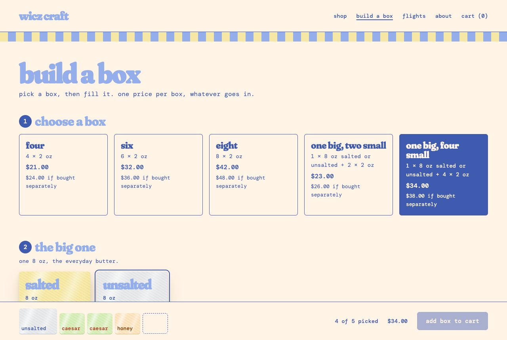
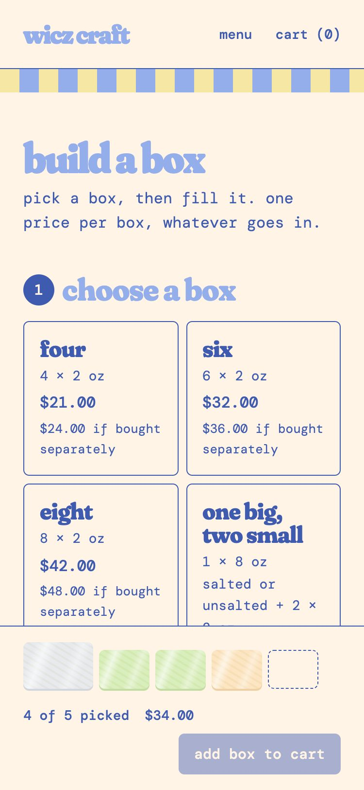
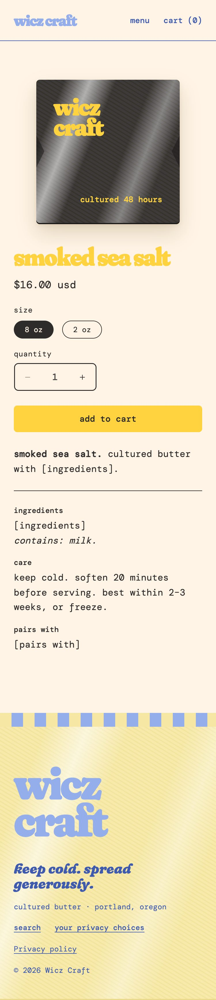
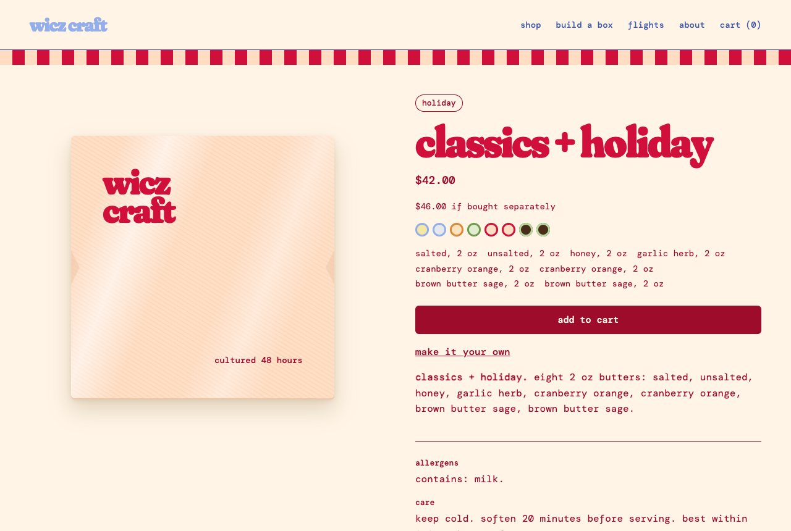

# wicz craft

A Shopify storefront for a fictional small-batch cultured butter company in
Portland, Oregon. Built on Dawn (Online Store 2.0) from a written
[design guide](docs/design-guide.md), with a **box builder** backed by a
**Cart Transform function**.

It's a practice and portfolio project: no real customers or payments.
Facts the guide doesn't know yet (most ingredients, some pairings) stay as
visible `[PLACEHOLDERS]`.


## What's interesting here

- **A box builder with flat prices.** Shoppers pick a box (four, six, eight,
  or one 8 oz plus 2 oz cubes) and fill it from twelve flavors. The box goes
  into the cart as one line at its flat price, and a Cart Transform function
  expands it into the butters inside, so each flavor's inventory is tracked.
  Flights are presets of the same box. [How it works ↓](#the-box-builder)
- **Product pages that theme themselves.** Each flavor has ground / ink /
  deep / fold colors in metafields. Pages, cards, buttons, dots and stripes
  pick them up through CSS custom properties, with contrast fallbacks
  computed in Liquid.
- **A design system enforced by an audit.** The guide's rules (lowercase, no
  flavor numbers, 6px or 999px radii, one gradient, light inks only at
  display sizes, WCAG AA for small text, unsalted always in silver foil) are
  checked page by page with a script, not by eye.
- **One catalog file.** `catalog/catalog.mjs` holds the flavors, colors,
  prices, box formats and flights. The CSV and the store seed script both
  read it.
- **Everything stays editable in the theme editor.** Sections, blocks and
  settings, no hard-coded pages.

## Screenshots

| | |
|---|---|
|  |  |
| **Box builder.** Pick a format, fill the slots; the tray shows the count and the flat price. | **Cart.** A box and a flight, each one line listing what's inside, next to a single. |
|  |  |
| **Box builder (375px).** The tray stays pinned to the bottom of the screen. | **Smoked sea salt (375px).** A dark ground: the button flips to a light fill with dark text. |
|  |  |
| **Flight.** A preset box, with "if bought separately" and a link to open it in the builder. | **Collection.** Mono filter chips and pack cards; holiday flavors get a pill. |

More: [home on mobile](docs/screenshots/home-mobile.jpg) · [about](docs/screenshots/about-desktop.jpg)

## The box builder

```
theme   sections/wicz-box-builder.liquid + assets/wicz-box-builder.js
        "build a box" has one variant per format, each with its slot counts
        in custom.box_big / custom.box_small
        → POST /cart/add, one line: the format's variant at its flat price
            big: unsalted, 8 oz      visible, listed in the cart
            slot 1: caesar …
            _components: 111,222,…   hidden: picked variant ids

app     app/wicz-craft-cartons/extensions/box-expand (Shopify Function, JS → Wasm)
        checks the picks against box_rules (an app-owned metafield on the
        cart transform): count, 8 oz salted/unsalted in the big slot, 2 oz elsewhere
        → one lineExpand into the picked variants; the box keeps its flat price
```

Details worth noting:

- **Why expand, not merge.** A box can cost more than its parts (four 2 oz
  salted are $20 as singles, the box is $21). Merging prices a bundle from its
  components; expanding starts from the bundle's own price.
- **Safe by construction.** The price comes from the variant bought, never
  from the cart properties. A box whose picks don't match the rules isn't
  expanded and stays one line at the box price.
- **Flights reuse the box.** A flight page posts the same line for the
  "eight" format, pre-filled. "make it your own" opens the builder with
  `?format=eight&flight=<handle>`.
- **Accessible.** Native radio groups for the format and the 8 oz, labelled
  add / remove buttons, a live region that announces every change, and an
  add button that stays disabled until every slot is filled.
- **Tested.** 13 unit tests plus 4 JSON fixtures run through the compiled
  Wasm and validated against the Cart Transform schema.
- **New flavors need no code.** Add one to `catalog/catalog.mjs` and re-run
  the seed: it shows up in the grid, the builder and the function's rules.

## Project layout

```
assets/, config/, layout/, locales/,     Dawn 16.2.0 theme, customized
sections/, snippets/, templates/           (wicz-* files are new; Dawn edits are commented)
app/wicz-craft-cartons/                  extension-only Shopify app (see its README)
  extensions/box-expand/                   Cart Transform function + tests
  scripts/seed-store.mjs                   loads the catalog and store setup
catalog/catalog.mjs                      12 flavors × 2 sizes, 5 box formats, 3 flights
catalog/build-csv.mjs                    product CSV for a manual import
docs/design-guide.md                     the design spec
tools/guide-audit.js                     design-guide audit, run in the browser console
tools/screenshots.mjs                    regenerates docs/screenshots
```

Key theme files: [`wicz-tokens.css`](assets/wicz-tokens.css) (design tokens),
[`wicz-flavor-vars.liquid`](snippets/wicz-flavor-vars.liquid) (metafield colors + contrast fallbacks),
[`wicz-box-builder.liquid`](sections/wicz-box-builder.liquid) and
[`wicz-box-builder.js`](assets/wicz-box-builder.js) (box builder),
[`wicz-flight.liquid`](sections/wicz-flight.liquid) (flight page),
[`wicz-flavor-card.liquid`](snippets/wicz-flavor-card.liquid) (product cards).

## Running it

Needs Node 22 (`.nvmrc`), [Shopify CLI](https://shopify.dev/docs/api/shopify-cli), and a development store.

1. **Theme preview:** `shopify theme dev --store <your-store>`
2. **App and catalog:** from `app/wicz-craft-cartons`, run `shopify app deploy`,
   then `shopify app dev --store <your-store>` and
   `node scripts/seed-store.mjs "<GraphiQL URL it prints>"`. That loads every
   product, metafield, collection and menu item, and registers the Cart
   Transform. (`node catalog/build-csv.mjs` writes a CSV of the same catalog
   for a manual import, but the import can't set list metafields, templates
   or the function config, so the seed is still needed.)
3. **Function tests:** `npm test --workspace box-expand -- --run` (from the app folder).

## Decisions and trade-offs

- **Dark-ground buttons use the deep color.** The guide says a dark ground's
  button is "ink" fill with ground text. Chili crisp's ink (`#FF8A3D`) on
  oxblood is 4.41:1, under AA for button text, so buttons use the deep color
  (`#FF9A55`, 4.92:1), which equals the ink on the other two dark grounds.
- **Small-text contrast is computed, not hand-tuned.** If a flavor's deep color
  fails 4.5:1 on cream, Liquid's `color_contrast` switches small text to the
  ground color. That covers the three dark grounds.
- **Placeholders stay visible.** Unknown ingredients and pairings show as
  `[INGREDIENTS]` / `[PAIRS WITH]`; caesar's allergen line asks to confirm
  fish. Nothing is invented.
- **Flavored 8 oz in a box isn't offered.** The guide leaves it as an open
  decision; the big slot is salted or unsalted.
- **Known gap:** the guide allows its light inks (periwinkle on cream, 2.04:1)
  for large display type. That meets the guide but not WCAG's 3:1 for large text.
